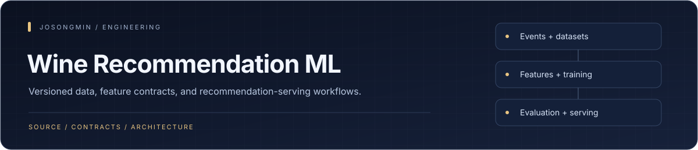
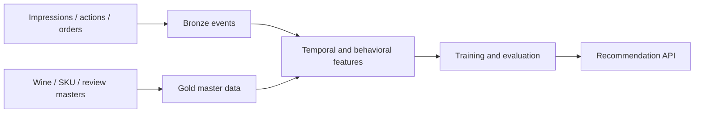

<p align="center"></p>

# Wine Recommendation Pipeline

An ML recommendation workspace connecting event ingestion, feature engineering, model training, evaluation, and serving. The Python implementation uses explicit schemas and ports/adapters around a layered data pipeline.


## Engineering highlights

| Mechanism | Engineering purpose |
| :--- | :--- |
| **Impression-centric datasets** | Data-building contracts organize events, labels, temporal joins, and lineage around impressions. |
| **Versioned features and models** | Feature manifests and model-registry interfaces expose dataset/feature/model identity across training and serving. |
| **Layered data pipeline** | Bronze events, Gold masters/derived features, and training data have distinct storage and transformation roles. |
| **Ports for infrastructure** | Storage and model-registry contracts separate core workflows from AWS adapters. |
| **Typed serving interface** | FastAPI recommendation responses include model and feature-set versions alongside ranked items. |

## Data-to-recommendation flow



The seed generator creates synthetic user profiles, reviews, and events for local development. Checked-in sample data is distinct from live customer traffic or production recommendation quality.

## Repository map

| Path | Responsibility |
| --- | --- |
| `src/wine_rec/schemas` | Typed event and data contracts |
| `src/wine_rec/contracts` | Shared interfaces |
| `src/wine_rec/ingestion` | Event collection and validation |
| `src/wine_rec/pipeline` | Batch transformations and training data |
| `src/wine_rec/features` | Feature construction and parity checks |
| `src/wine_rec/models` | Baselines, training, and evaluation |
| `src/wine_rec/serving` | FastAPI recommendation service |
| `src/wine_rec/infra` | AWS adapters |
| [scripts/seed_data.py](scripts/seed_data.py) | Reproducible local data generation |

## Start locally

Use Python 3.11+, uv, and Just. Select the ML dependencies required by the workflow rather than assuming every optional model stack is installed.

```sh
just setup
just pipeline
just check
just test
just serve
```

`just pipeline` generates Bronze/Gold data and builds training inputs. For narrower work:

```sh
just seed
just pipeline-fast
```

The pipeline follows impression-centered labels, temporal joins, and explicit lineage. Local generated-data results do not establish production ranking quality or leakage safety on a different dataset.

## Tooling and environments

| Area | Tooling |
| --- | --- |
| Python environment | uv |
| Formatting/lint | Ruff |
| Types | basedpyright |
| Tests | pytest |
| Models | PyTorch and optional recommendation/graph libraries |
| Serving | FastAPI |
| Infrastructure | AWS adapters and Terraform material |

E2E infrastructure tests require the services described by the test setup, including LocalStack where selected. Cloud training/deployment additionally requires explicit AWS configuration and permissions.

## Status and documentation

The repository contains implementation, synthetic data, and tests. Historical test counts and coverage percentages are snapshot-specific; use a fresh result from the selected configuration rather than treating this README as a release receipt.

- [Testing](TESTING.md)
- [Design RFC index](rfc/README.md)
- [Package and dependency configuration](pyproject.toml)
- [Seed generator](scripts/seed_data.py)
